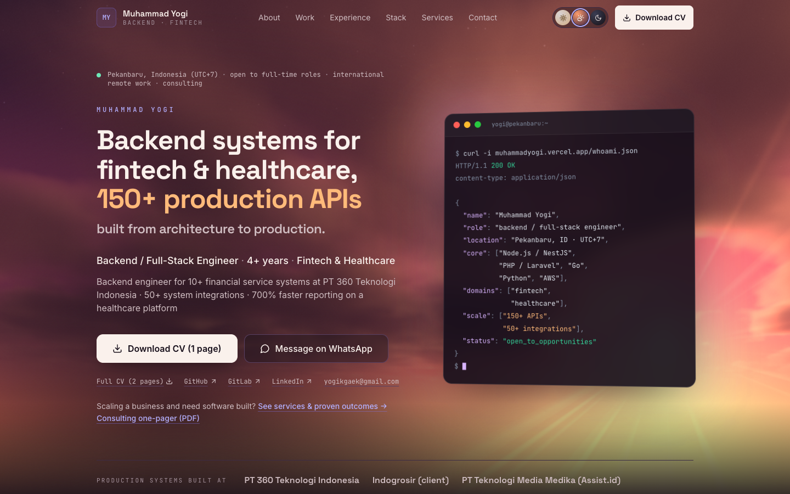

<h1 align="center">👋 Muhammad Yogi — Backend / Full-Stack Engineer</h1>

<div align="center">

[](https://muhammadyogi.vercel.app)
[](https://www.linkedin.com/in/yogigaek)
[](https://github.com/yogigaek)
[](mailto:yogikgaek@gmail.com)
[](https://github.com/yogigaek/Portfolio-Latest/actions/workflows/ci.yml)

</div>

<h3 align="center">☁️ AWS Serverless financial platforms at scale · 150+ production APIs, 50+ system integrations</h3>

<p align="center">
  
</p>

---

## 📑 Contents

- [🎯 Professional profile](#-professional-profile)
- [🧩 Open source](#-open-source)
- [🛠️ Tech stack](#️-tech-stack)
- [🖥️ About this repo](#️-about-this-repo)
- [🗺️ Routes](#️-routes)
- [✏️ Updating content](#️-updating-content)
- [🚀 Local development](#-local-development)
- [☁️ Deployment](#️-deployment)
- [📬 Contact](#-contact)

---

## 🎯 Professional profile

Backend / Full-Stack Engineer (4+ yrs) building mission-critical financial and healthcare systems across
cloud-native, distributed architectures. Currently delivering **10+ financial service projects end-to-end** at
PT 360 Teknologi Indonesia — payment platforms, credit facilities, POS, and 40+ bank/partner integrations, built
on **AWS Serverless** (Lambda, SQS, API Gateway) with auth secured per requirement (OAuth 2.0, HMAC, JWT, RSA,
AES-256). Architected the **NestJS platform migration** off Lambda microservices, consolidating three standalone
projects into one monolith with full OpenTelemetry observability.

**✨ Highlights**

- 🔌 **150+ production APIs** — 100+ for payment, credit facility & POS systems in fintech, 50+ for a healthcare platform
- 🔗 **50+ system integrations** — 40+ with banks, partners & enterprise platforms (zero missed deadlines), 10+ on the healthcare platform
- ⚡ **~2x faster than planned** — projects typically delivered in about half the planned time across the engagement
- 🚀 **700% faster reporting** — MongoDB aggregation rewrite & materialized views (AUDY healthcare platform; 10,000+ records cleaned up automatically, zero data loss)
- 🏗️ **3 Lambda projects → 1 NestJS monolith** — architected & led the credit facility platform migration, 50+ APIs rebuilt with full observability

---

## 🧩 Open source

Code you can read, shown in the **Open source** block of the Work section.

| Project | What it is | Links |
| --- | --- | --- |
| 🚲 **Rakit** | E-bike parts store with a 3D configurator: NestJS + PostgreSQL decide every price, rule and stock change; oversell-safe checkout, idempotent orders, signed Midtrans webhooks; API and browser tests in CI | [Live demo](https://yogi-store.vercel.app) · [Case study](https://muhammadyogi.vercel.app/projects/rakit) · [Source](https://github.com/yogigaek/gear-store) |
| 🐹 **Webhook Relay** | Go service that verifies payment-provider webhooks, stores each event once in PostgreSQL and relays it with retries, backoff and a dead-letter state | [Source](https://github.com/yogigaek/webhook-relay) |

---

## 🛠️ Tech stack

| | |
| --- | --- |
| 💬 **Languages** | TypeScript, JavaScript, PHP, Go, Python |
| ⚙️ **Backend** | Node.js, NestJS, Express.js, Laravel, LoopBack, REST API Design, Zod, class-validator |
| ☁️ **Cloud & DevOps** | AWS Lambda, SQS, SNS, API Gateway, S3, ECR, Serverless Framework, Docker, Kubernetes, CI/CD, Git |
| 🗄️ **Databases** | PostgreSQL, MySQL, MongoDB, Redis, Prisma ORM, Mongoose, Query Optimization, Database Design |
| 🏛️ **Architecture** | System Design, Clean Architecture, Microservices, Distributed Systems, Event-Driven Architecture, Software Architecture |
| 📨 **Messaging & Integration** | RabbitMQ, WebSocket, API Integration, Webhook Integration |
| 🔐 **Security & Auth** | OAuth 2.0, JWT, HMAC, AES-256, RSA Encryption |
| 🧪 **Testing & Quality** | Unit Testing, Integration Testing, Jest, Supertest, k6, Performance Tuning |
| 📈 **Observability & Tools** | OpenTelemetry, Prometheus & Grafana, CloudWatch, Swagger/OpenAPI, Postman, AI-Assisted Development |
| 🎨 **Frontend** | React, Inertia.js, Tailwind CSS, Material UI |

---

## 🖥️ About this repo

Source of my portfolio site, live at **[muhammadyogi.vercel.app](https://muhammadyogi.vercel.app)**. A single-page
React + TypeScript site built with Vite and Tailwind CSS:

- 🌅 **Three time-of-day looks** — day, dusk and night, picked from the visitor's local time and switchable from the topbar.
- ☁️ **A dependency-free WebGL2 sky** in the hero — raymarched volumetric clouds on capable desktops, a lighter shader
  on phones, a Canvas 2D fallback; sun, moon, stars and god rays, with a one-time cinematic intro.
- 💻 **A typed `whoami` terminal**, editorial numbered sections, and a sticky topbar with an accessible mobile drawer.
- 🎞️ **Framer Motion reveals** that respect `prefers-reduced-motion`.
- ✉️ **An EmailJS-powered contact form.**
- ✅ Deployed to **Vercel** through its native Git integration and gated by a **GitHub Actions** CI workflow on every push and PR.

**Where things live**

| Path | What it holds |
| --- | --- |
| 📦 [`src/data/index.ts`](src/data/index.ts) | **Single source of truth** for all site content: location & timezone, outcomes, work experience, education, quick facts, skills, projects, testimonials, contact info |
| 🧭 [`src/components/layout/`](src/components/layout/) | Topbar (sticky nav + mobile drawer), Footer, MainLayout |
| 🧱 [`src/components/sections/`](src/components/sections/) | Hero (claim, terminal, proof strip), Outcomes, About (quick facts), Projects (enterprise case studies + open source + earlier projects), Work Experience (timeline + education), Tech Stack, Services (with EN/ID consulting one-pager PDFs), Testimonials, Contact |
| 📄 [`src/components/pages/ProjectDetail.tsx`](src/components/pages/ProjectDetail.tsx) | Lazy-loaded project page: a case study for each enterprise project, a screenshot walkthrough (with a "How it works" architecture panel when there is one) for each project with screenshots. Which projects get a page: `hasProjectPage` in `src/lib/seo.ts` |
| 🧩 [`src/components/ui/`](src/components/ui/) | Reusable primitives (Button, Badge, SectionHeader, Reveal, GitHubIcon, ArchitecturePanel) |
| 👀 [`src/hooks/useScrollSpy.ts`](src/hooks/useScrollSpy.ts) | Active nav section tracking |
| 🌤️ [`src/lib/look.ts`](src/lib/look.ts) + [`src/components/ui/sky/`](src/components/ui/sky/) | Look state (persisted, synced to `theme-color`) and the hero sky: WebGL2 renderer, Canvas 2D fallback, and the shared animation loop (pauses offscreen, adaptive resolution, reduced motion). Colours are RGB token triplets per look in [`src/index.css`](src/index.css); the first look is set by an inline script in `index.html` before first paint |
| 🔀 [`vercel.json`](vercel.json) | SPA rewrite so deep links such as `/projects/mern-ecommerce` load directly, `cleanUrls` so `/projects/<id>` serves the build's `projects/<id>.html`, plus cache and security headers |
| 🔎 [`src/lib/seo.ts`](src/lib/seo.ts) + `projectPages` in [`vite.config.ts`](vite.config.ts) | `npm run build` writes a static `dist/projects/<id>.html` per project page (own title, description, canonical, so link previews and crawlers that skip JavaScript see the project) and regenerates `dist/sitemap.xml`; `public/sitemap.xml` is a dev copy |

---

## 🗺️ Routes

| Route | Description |
| --- | --- |
| `/` | Main portfolio (all sections) |
| `/projects/nestjs-migration`, `/projects/financial-platform`, `/projects/application-gateway`, `/projects/monitoring-platform`, `/projects/healthcare-system` | 🔒 Enterprise case studies (NDA): role, overview, outcomes, architecture |
| `/projects/rakit` | 🚲 Rakit walkthrough: how it works, screenshots, live demo and source |
| `/projects/mern-ecommerce` | 🛒 MERN e-commerce project detail |
| `/projects/php-ecommerce` | 🛍️ PHP e-commerce project detail |
| `/detail`, `/detail2` | ↪️ Legacy redirects to the routes above |
| `*` | 🚫 404 page (`noindex`); unknown `/projects/:id` too |

---

## ✏️ Updating content

Everything lives in `src/data/index.ts` — edit that file, not the section components:

| What | Where |
| --- | --- |
| 📍 Location & timezone | `LOCATION` |
| 🟢 Availability | `AVAILABILITY` |
| 💻 Hero/terminal stack | `CORE_STACK` |
| 🔗 Social links | `CONTACT_INFO` |
| 📊 Headline numbers | `outcomes` |
| 🧰 Services | `services` |
| 💼 Work experience & education | `workExperiences`, `education` |
| ⚡ About quick facts | `quickFacts` |
| 🛠️ Skills | `skills` |
| 📁 Projects | `projects` |
| 💬 Testimonials | `testimonials` |

How a project is shown depends on its fields:

- 🔒 **Enterprise** (`featured: true`) — an NDA case study; its architecture panel is drawn from `architectureLabel`
  (`A → B → C · extra · extra`).
- 🧩 **Open source** (`type: 'Open Source'`) — a card in the Open source block, with links to the source and, when
  set, a live demo; it gets a walkthrough page when it has `screenshots`.
- 🗂️ **Personal** — listed under "Earlier projects".

---

## 🚀 Local development

npm runs the scripts; Vite handles development, bundling and image optimization.

```bash
npm install
npm run dev      # http://localhost:5173
npm run lint     # ESLint
npx tsc --noEmit # type-check
npm run build    # type-check + production build in dist/
npm run preview  # preview the production build
```

### 🔑 Environment variables

Create a `.env.local` file in the root directory for the contact form (EmailJS):

```env
VITE_EMAILJS_SERVICE_ID=your_service_id
VITE_EMAILJS_TEMPLATE_ID=your_template_id
VITE_EMAILJS_PUBLIC_KEY=your_public_key
```

---

## ☁️ Deployment

- 🚀 **Vercel** is connected to this repository through its native Git integration: every push to `main` triggers a
  production build & deploy, and every pull request gets a preview deploy. No deploy step lives in this repo.
- ✅ [`.github/workflows/ci.yml`](.github/workflows/ci.yml) is the **CI gate**, not the deploy mechanism: on every
  push to `main`/`yogi` and every PR to `main`, it runs type-check, lint and build to catch regressions before they
  reach `main`.

---

## 📬 Contact

- 📧 **Email:** [yogikgaek@gmail.com](mailto:yogikgaek@gmail.com)
- 💼 **LinkedIn:** [linkedin.com/in/yogigaek](https://www.linkedin.com/in/yogigaek)
- 🐙 **GitHub:** [github.com/yogigaek](https://github.com/yogigaek)
- 🦊 **GitLab:** [gitlab.com/yogigaek](https://gitlab.com/yogigaek)
- 🧠 **LeetCode:** [leetcode.com/u/yogigaek](https://leetcode.com/u/yogigaek/)
- 💬 **WhatsApp:** [+62 821 6971 3434](https://wa.me/6282169713434)

🟢 Open to full-time roles, international remote work, and consulting.

---

<p align="center">Personal portfolio — all rights reserved.</p>
